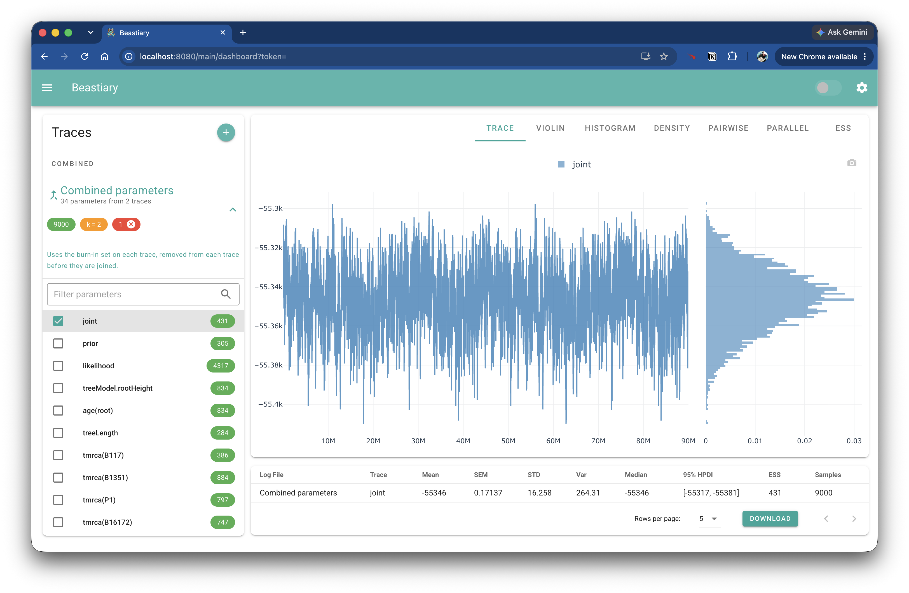

Often the same analysis is run several times (multiple chains, or independent runs with different seeds). Beastiary can combine the parameters that appear in more than one loaded trace into a single **combined** parameter, so you can plot and summarise all the runs together.

This works like BEAST's [LogCombiner](https://beast.community/logcombiner): the burn-in is removed from each log, each log is thinned, and the logs are joined end to end.

# Turn on combining

Combining is off by default. Open the settings (the cog button at the top right) and, under **Combine parameters**, set **Combine** to `Combine all (same name parameters)`. See [Settings](settings.md) for the other options.

Then load two or more log files that share parameter names (for example `joint`, `likelihood` or `treeLength`).

# The combined trace

A **Combined** section appears at the top of the trace list, above the **Traces** section. It contains one entry, `Combined parameters`, which shows how many parameters it contains and how many traces they came from.

The chips on the entry show:

- the number of samples in the combined trace (green)
- the thinning interval, `k` (orange)
- the number of selected parameters (red). Click the `x` on the chip to clear the selection.

Click the entry to open it and select parameters, exactly as you would for a normal trace. The selected combined parameters are then shown in the plots, ESS and statistics alongside your other traces.

!!! note

    A parameter is combined when **two or more** loaded traces have a parameter with that name, whether or not it is selected in those traces. Parameters found in only one trace are not combined. Traces whose samples have not loaded yet are skipped until they have.

# How the traces are combined

For each combined parameter, Beastiary does the following with every trace that has it:

1. **Burn-in.** The burn-in set on the individual trace is removed. The combined trace has no burn-in of its own (there is no burn-in slider on it), so set the burn-in on the individual traces.
2. **Thinning.** The remaining samples are thinned, keeping samples `k`, `2k`, `3k` and so on.
3. **Joining.** The thinned traces are placed one after the other, in the order they were loaded.

Each trace is thinned separately, rather than thinning the joined samples, so every trace is equally represented. Because this is done before the combined trace is plotted, the ESS and statistics for combined parameters are calculated from the thinned samples.

Changing a trace's burn-in, or new samples arriving in a trace, updates the combined trace automatically.

# Thinning the combined traces

The **Thinning** setting controls the interval `k`:

| Option | Behaviour |
| --- | --- |
| Automatic | `k` is the number of traces combined into that parameter. If the traces are the same length, the combined parameter is about as long as a single trace. A parameter found in 2 traces uses `k = 2` and one found in 3 traces uses `k = 3`, so the `k` shown can be a list when parameters differ. |
| Custom interval | Use the interval you enter, for every combined parameter. |
| Off | `k = 1`, so every sample after burn-in is kept. The combined trace is as long as all the traces added together. |

!!! tip

    Thinning only reduces the sample count, it does not change the posterior. If the combined trace has more samples than you need, use `Automatic`. If you want the full set of samples to compute the ESS, use `Off`.

# Example

You have run three chains of the same analysis, `run1.log`, `run2.log` and `run3.log`, each with 10,000 samples and a 10% burn-in.

1. Load the three logs.
2. In the settings, set **Combine** to `Combine all (same name parameters)`.
3. Open `Combined parameters` at the top of the trace list and select `posterior`.

With automatic thinning, 9,000 samples from each trace remain after the burn-in and every third is kept, giving 3,000 samples per trace and 9,000 in the combined `posterior`. The plots then show all three chains as one trace, and the ESS reflects the three chains together.
