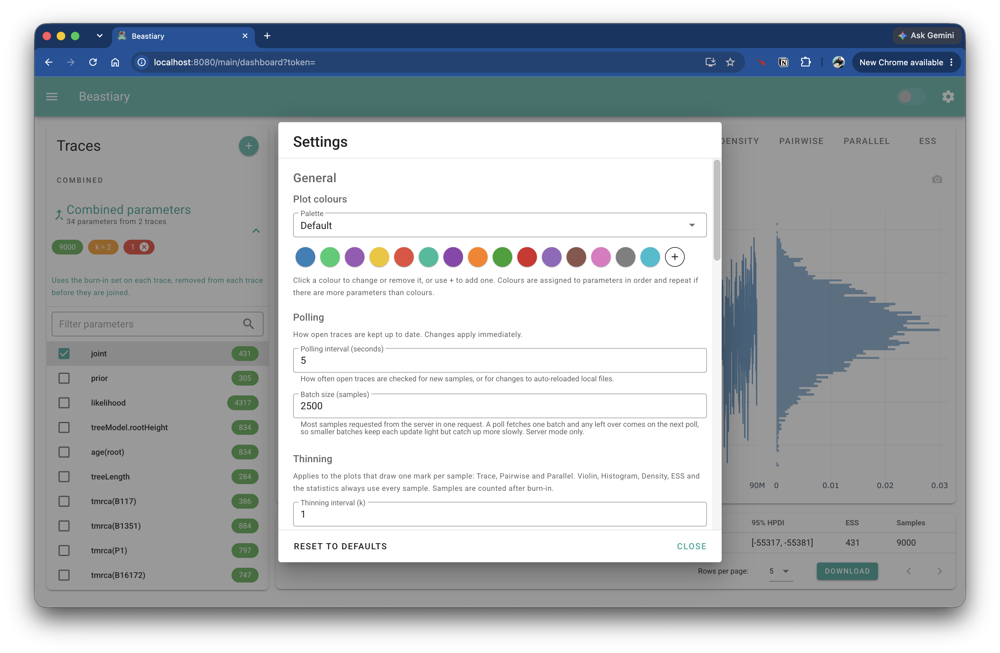

Beastiary's settings control how the plots look and how the samples are processed. Open them with the cog button at the top right of the app bar.

Settings are saved in your browser (local storage under the key `beastiary-settings`), so they are still there the next time you open Beastiary. Invalid values are ignored and the default is used instead. Use `Reset to defaults` to restore everything, and `Close` to dismiss the dialog. Changes are applied to the plots straight away.

!!! note

    Settings belong to the browser, not to the log file or the Beastiary server. If you open Beastiary in a different browser you will see the defaults again.

# General

## Plot colours

The palette used to colour the parameters in the plots.

- Choose a preset from the select box, or `Custom` once you have changed a colour.
- Click a colour swatch to open a colour picker and change that colour.
- Use the `+` button to add a colour and `Remove colour` to delete one. At least one colour is always kept.

Colours are given to the parameters in order, and the palette repeats when there are more parameters than colours.

## Polling

| Setting | Default | Description |
| --- | --- | --- |
| Polling interval | 5 seconds | How often Beastiary checks for new samples (and for changes to auto-reloaded local files). |
| Batch size | 2500 samples | How many samples are requested at a time from a Beastiary server. This is used when a trace is first opened and when polling for new samples. |

The batch size only matters when you are running Beastiary with a server (see [Logs from the command line](logs-from-the-command-line.md)).

## Thinning

Thinning keeps every `k`-th sample and throws the rest away. With an interval of `k = 5` you keep samples 5, 10, 15, 20, and so on.

The default is `k = 1`, which keeps every sample. Thinning is useful when a trace has so many samples that the plots become slow.

!!! note

    The thinning interval only affects the **Trace**, **Pairwise** and **Parallel** plots. The Violin, Histogram and Density plots, the ESS plot and the statistics table always use every sample. Samples are counted after the burn-in has been removed.

## Combine parameters

These settings control the [combined parameters](combining-parameters.md) section of the trace list.

| Setting | Options | Description |
| --- | --- | --- |
| Combine | `Don't combine` (default), `Combine all (same name parameters)` | Whether parameters with the same name in different traces are combined. |
| Thinning | `Automatic` (default), `Custom interval`, `Off` | How each trace is thinned before the traces are joined. |
| Thinning interval | 2 | The interval used when thinning is `Custom interval`. It must be a positive integer and is only enabled for the custom option. |

# Plots

The plot settings are listed in the same order as the plot tabs.

## Histogram

| Setting | Default | Description |
| --- | --- | --- |
| Bins | 0 | The number of bins. `0` chooses the number of bins automatically. |
| Opacity | 0.6 | The opacity of the bars (0.05 to 1). |

These settings also apply to the histogram drawn alongside the **Trace** plot.

## Density

| Setting | Default | Description |
| --- | --- | --- |
| Grid size | 512 | The number of points at which the kernel density estimate is evaluated. |
| Bandwidth scale | 1 | Multiplies the automatically chosen bandwidth (0.1 to 5). Values below 1 follow the data more closely, values above 1 give a smoother curve. |
| Fill opacity | 0.4 | The opacity of the area under the curve. |

## Pairwise

| Setting | Default | Description |
| --- | --- | --- |
| Point size | 5 | The size of the points (1 to 20). |
| Point opacity | 0.4 | The opacity of the points. Lower values make dense regions easier to see. |

## ESS

The ESS plot shows the cumulative effective sample size.

| Setting | Default | Description |
| --- | --- | --- |
| Step k | 100 | The ESS is calculated every `k` samples. Larger values are faster to compute. |
| Low threshold | 100 | An ESS below this value is shown in red. |
| High threshold | 200 | An ESS at or above this value is shown in green. Values between the two thresholds are orange. |

The thresholds also set the colour of the ESS chips in the trace list. The low threshold must be smaller than the high threshold.

# Statistics

| Setting | Default | Description |
| --- | --- | --- |
| HPD interval width | 0.95 | The width of the highest posterior density interval in the statistics table (0.5 to 0.999). |
